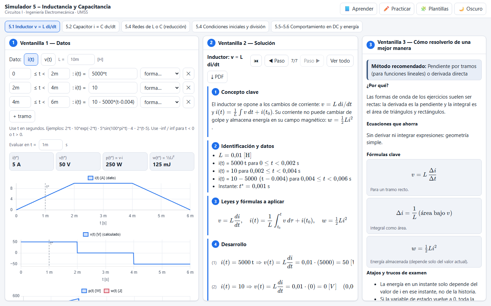
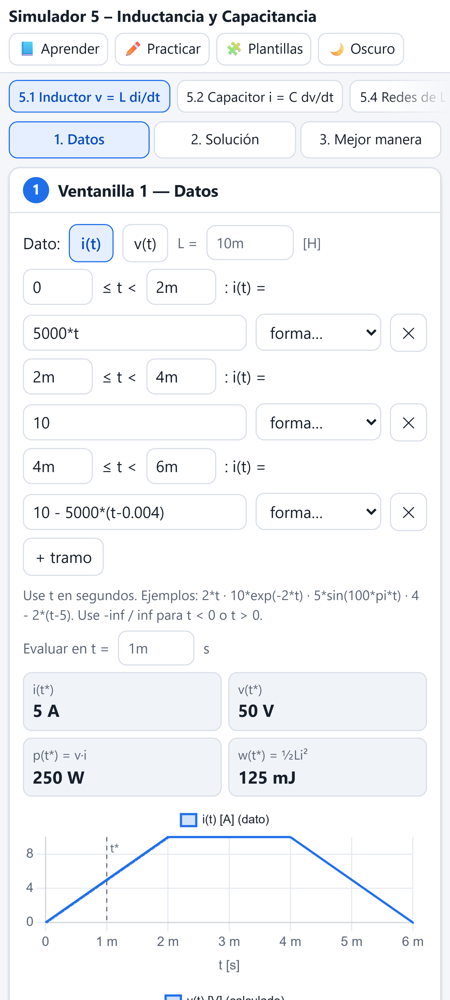

# Simulador 5 – Inductancia y Capacitancia

Simulador web de la **Unidad 5 de Circuitos I** (sigla 197900021, Ingeniería Electromecánica, UMSS – Cochabamba; docente Ing. Abg. Juan Antonio Rodríguez Sejas). Cubre el inductor y el capacitor: sus relaciones v–i, las formas de onda por tramos, las reglas de continuidad, las combinaciones serie y paralelo con condiciones iniciales y el comportamiento en DC con la energía almacenada.

**Página publicada:** https://angelja19.github.io/simulador-5-inductancia-y-capacitancia/

| Escritorio | Celular |
| --- | --- |
|  |  |

## Funciones

- **5.1 Inductor:** se dibuja i(t) o v(t) por tramos (rectas, rampas, exponenciales, senoidales o fórmula libre). El simulador calcula v = L di/dt, o i(t) = (1/L)∫v dt + i(t₀), además de p(t) y w = ½Li², con gráficas.
- **5.2 Capacitor:** lo mismo con i = C dv/dt, v(t) = (1/C)∫i dt + v(t₀) y w = ½Cv².
- **Reglas de continuidad:** si la forma de onda hace saltar i_L o v_C (también en los extremos de los tramos), el simulador avisa que se necesitaría un impulso y explica por qué no es físico.
- **5.4 Redes de L o C:** reducción serie‑paralelo animada en el editor, entre los terminales que se elijan.
- **Condiciones iniciales y división:** capacitores en serie con voltajes iniciales (carga común y división de voltaje), inductores en paralelo con corrientes iniciales e inductores en serie como divisor de voltaje.
- **5.5–5.6 Comportamiento en DC:** el inductor actúa como cortocircuito y el capacitor como circuito abierto. Se calcula la energía almacenada en cada uno dentro de un circuito resistivo, y el validador detecta un L en paralelo con una fuente de voltaje o un C en serie con una fuente de corriente.

Cada herramienta tiene las tres ventanillas (datos o armado, solución en 7 puntos y mejor manera), además de Aprender, Practicar, Plantillas y tema claro u oscuro. Las fórmulas del material del curso están en [`docs/formulas.md`](docs/formulas.md).

## Uso

```bash
npm install
npm run dev
npm test           # Vitest
npm run test:e2e   # Playwright, escritorio y celular
```

Licencia [MIT](LICENSE).
